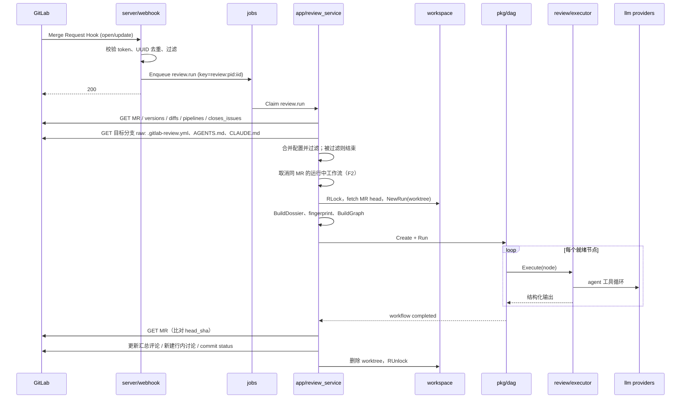

# 05 关键流程

> 每个流程列出参与组件、步骤和调用的 GitLab API。实现时按步骤写函数，每一步失败的处理也写在这里。

---

## F1 MR 打开或更新 → 评审 → 发布

### 步骤与失败处理

| # | 步骤 | 失败处理 |
|---|---|---|
| 1 | webhook 校验、去重、入队 | 认证失败 401；请求体读取超时或存储失败 503（不写去重记录）；其他输入异常等返回 200。重发和 hook 状态见[运维指南](../operations.md#webhook-失败与恢复) |
| 2 | worker 领取 job | 租约 5 分钟，执行中每分钟续期 |
| 3 | 取消旧工作流（F2；在采集和过滤后） | 过滤命中时不会到达此步 |
| 4 | 拉取 MR 元数据：`GET /projects/:id/merge_requests/:iid` | MR 已关闭或合并 → job 完成，不评审 |
| 5 | `GET .../merge_requests/:iid/versions` 取最新版本的三个 sha | 失败 → job 重试 |
| 6 | `GET .../merge_requests/:iid/diffs`（翻页） | 同上 |
| 7 | `GET .../merge_requests/:iid/pipelines`，取最新一条；有失败 job 时 `GET /projects/:id/pipelines/:pid/jobs` | 失败不阻塞，`Pipeline=nil` |
| 8 | `GET .../merge_requests/:iid/closes_issues` | 失败不阻塞 |
| 9 | 读目标分支上的 `.gitlab-review.yml`、`AGENTS.md`、`CLAUDE.md`：`GET /projects/:id/repository/files/:path/raw?ref=<target>` | 404 视为没有 |
| 10 | 合并配置（平台 → 项目 → 仓库）；worker 按合并后的设置复核 Draft/标签/目标分支（`allow_repo_config=true` 时包含目标分支仓库配置）；计算 ignore；记录 included、ignored、omitted 和变更总数；增量范围 | 项目设置无法安全解析，或已启用的仓库配置 YAML 解析失败 → 停止此次执行，不回退为较宽松规则；被过滤的自动评审在创建 workflow 前结束 |
| 11 | 工作区 `RLock`；`git fetch refs/merge-requests/<iid>/head`；`git worktree add <runs>/<wf> <head_sha>` | fetch 失败 → job 重试 |
| 12 | 变更文件为 0：全被 ignore → 发布「无需评审」的汇总；全被采集缺口 omitted → 不建 workflow，发布 INCOMPLETE 摘要，列出 omitted 总数、原因计数和最多 4 条路径，其余只计数。两者都结束 | — |
| 13 | `BuildGraph` → `Engine.Create` → `Engine.Run` | 工作流 failed → F1-失败分支 |
| 14 | 发布（F7） | GitLab 写入失败 → 重试 3 次；可重试失败保持 `publication_state=pending`，永久失败标为 `failed`；控制台可手动 republish |
| 15 | 清理 worktree，释放锁 | 正常路径清理失败只记日志，不改变已完成评审；后台 run cleanup 定期删除未被引用且超过 `workspace.run_cleanup_after` 年龄的遗留 run |

> 实际执行顺序：步骤 1–2 后，先做步骤 4–10 的采集、配置合并和过滤；未被过滤的自动评审才执行步骤 3 的取消，然后继续步骤 11。

> 空评审（步骤 12）不创建工作流，也不新增 skipped 工作流记录。全部被 ignore 时仍是「无需评审」的 PASS 摘要；全部变更文件都因 `max_files`、`max_diff_lines`、`too_large` 或 `collapsed` 等采集缺口 omitted 时，不创建空 workflow，只发布 INCOMPLETE 摘要：列出 omitted 总数、原因计数和最多 4 条路径，其余只计数；正常 dossier 保留完整的 omitted 列表。该记录方式沿用 2026-10-23 用户确认的 Issue #10 本地验收口径；历史记录不补造不存在的 dossier 或逐路径 omitted 清单。发布前的最终代次检查会拒绝检查时已被新代次取代的结果。

> `DiffSummary.files` 表示进入材料快照的文件数，不是已评审数；`ignored` 是规则排除，不计为覆盖缺口。部分文件 omitted、评审节点实际遇到的文件/包文本截断、完成 plan 后非 generated included 文件未分配给评审节点、review 通道证据不足或 gate BLOCKING 无 accepted finding 时，评审继续执行但最终 verdict 为 INCOMPLETE，不能无提示 PASS。
>
> 现有限制：最终检查与 GitLab 写入不是原子操作。新代次若在两者之间到来，旧摘要仍可能写入；后续评审成功发布时会更新汇总，没有后续成功发布时不保证自动纠正。因此不能把当前实现解释为「过期摘要绝不会发布」。

**F1-失败分支**：工作流 `failed` 时，若项目设置 `post_failure_note=true`（默认 true），发布或更新汇总评论为「⚪ 评审未完成：<原因>」，不写 commit status。

模型循环在至少完成一轮后失败时，agent 会返回已发生的 partial usage。非 `synthesize` 节点仍只对 transport 错误重试；每次重试把上一次已知 partial usage 带入下一轮共享预算检查，最终节点 usage 也包含这些已知用量。上游未返回 usage 的请求仍无法精确计费，跨重试 token/成本只能按已知边界使用，不能当账单。`synthesize` 的预算中断或 transport 失败不重试，直接使用确定性规则兜底，并保留这次调用已知的 partial usage；兜底不是重试成功。

Anthropic 的输入用量将未缓存、缓存读取和缓存创建各计一次，缓存字段仅作明细；执行器和调度器的 token 预算使用完整输入与输出。成本对全部输入使用配置的单一输入费率，不区分缓存价格，不是供应方精确账单；历史已保存用量不回填。

### 增量评审

- 上次已发布的工作流记录了 `head_sha`。新工作流在 `trigger=mr_update` 且非 `full` 时，只把 `git diff <last_head>..<head>` 涉及的文件作为评审范围；diff 内容仍取 MR 相对 base 的完整 diff，以保证行号映射正确。
- 上次的 head 不再是当前 head 的祖先（force push）→ 自动退回全量。

---

## F2 新 push 取消旧评审

1. webhook、已授权的评论命令或手动 API 在入队事务内记录同 `(project_id, mr_iid)` 的最新评审代次或取消意图。重复 delivery 不增加代次。
2. 取消不能依赖领取同 key 的后继 `review.run`：M0 队列只会在旧任务结束后领取后继。控制任务独立于长评审执行；运行中的评审也检查持久化意图，不能只靠内存通知。
3. 旧评审在创建工作流前检查代次，运行中发现已被替代时调用 `Engine.Cancel`。取消返回前应持久化工作流终态，并取消节点 context。用户取消不作为可重试的执行失败。
4. 旧工作流不会发布任何内容。发布前同时检查代次与完整 fingerprint，拦住创建前取消、进程重启和迟到结果。
5. 旧 job 结束后，新工作流开始 F1 第 4 步。即使 `jobs.workers=1`，控制路径也必须可执行。

---

## F3 评论命令

M0 先把命令持久化为 `review.command`，以下 GitLab 校验由 worker 执行，不在 webhook handler 内执行。worker 完成权限校验、help/拒绝回复和目标任务入队；它不执行评审。受理 run/cancel 时，入队事务记录源 note 的 eyes；help/拒绝不添加表情。webhook handler 不添加 emoji，也不做网络调用。

1. Note Hook 到达，正文以 `/review` 开头。
2. 忽略：作者是项目 bot 用户；MR 已关闭或合并。
3. 校验权限：`GET /projects/:id/members/all/:user_id`，`access_level < 30` → worker 回复一条「需要 Developer 及以上权限」说明，丢弃命令，不创建评审任务。
4. 解析命令（03-http-api.md §6）：
   - `/review`、`/review full`、`/review <profile>` → 入队 `review.run`（trigger=`command`，带 `full`、`profile`、`triggered_by`）。
   - `/review cancel` → 入队 `review.cancel`。
   - `/review help` → worker 回复可用命令和档位说明，不创建评审任务。
5. 两类回复都使用 worker 自己的隐藏 per-note marker（`command-reply note=<source_note_id>`），按源 note 查找并更新已有回复，因此任务重试不会重复创建。受理 run/cancel 时，入队事务在源 note 上设置 eyes；任务进入终态后，状态 worker 将自有 reaction 协调为完成/失败标记或清除。help/拒绝不添加表情；webhook 自身不添加 emoji，也不做网络调用。机器人评论和 command-reply note 不会再次触发。

---

## F4 目标分支 push → 刷新工作区

1. Push Hook 到达，`ref` 匹配目标分支 → 入队 `workspace.refresh`（key=`ws:<pid>`，自动合并重复）。
2. 工作区 `Lock`（等待进行中的评审释放读锁，最长 10 分钟，超时则延后重试）。
3. `git fetch`，`base/` 检出到新的 `after` sha；`workspaces.base_sha` 更新。
4. 外部索引增量更新（如 `codebase-memory-mcp cli index_repository`，cwd 为 `base/`）。非取消的索引失败不阻断刷新，保留旧 `index_sha`；其他必要步骤及状态保存成功时最终 `state=ready` 并记录固定的索引失败消息。
5. 判断是否重新生成上下文文档：自上次生成以来变更文件数 ≥ `context_refresh.changed_files`，或时间 ≥ `context_refresh.max_age`，且当前文档未锁定 → 运行 onboarding 工作流（F5 第 4 步起）。
6. 释放锁。

---

## F5 项目注册与 onboarding

1. 管理员调用 `POST /api/v1/projects`（03-http-api.md §4.1），服务端校验 token 和 scope。
2. 可选：创建 webhook。
3. 入库，`workspaces.state=new`，入队 `workspace.onboard`。
4. onboarding job：
   1. `state=onboarding`；`EnsureMirror` + 检出 `base/`。
   2. 建外部索引（按平台和项目配置的 MCP 中声明了 `index_command` 的服务器）。
   3. 读取目标分支上的 AGENTS.md / CLAUDE.md。
   4. 创建 onboarding 工作流（单节点），产出 `OnboardingOut`。
   5. 渲染为 Markdown，追加到 `context_docs`（`source=generated`）；若当前 active 版本已锁定，新版本保存但不切换。
   6. `state=ready`。
5. 进入 onboarding 后的关键步骤失败时，尝试设置 `state=error`，`last_error` 使用固定消息，不记录错误原文。非取消的索引失败是例外：继续生成上下文，生成及状态保存成功后 `state=ready` 并记录固定的索引失败消息。预检查或锁失败沿用直接返回的行为；取消后 context 已失效时，状态保存也可能失败，不能保证一定写入 `error`。

---

## F6 崩溃恢复

服务启动时依次执行：

1. `jobs`：`state=running` 且租约过期的任务改回 `queued`；`attempts` 只在下一次领取时加一，避免重复计数。已达到 `max_attempts` 的标为 `failed`；若已有同 key 的更新 queued 后继，取消旧任务而不覆盖后继。
2. 应用层先恢复工作流对应的脱敏材料快照、配置与 prompt 快照、工作区读锁及 head worktree，再调用 `Engine.Recover`。不得重新采集当前输入并与已完成节点的旧结果混用。对每个未终态工作流，
   - `running` 节点：写 `node.restarted`，重置为 `pending`，`attempt+1`。
   - `queued` 节点：保持 `queued`（幂等重入）。
   - 然后重新进入调度循环。
3. 评审节点无副作用，重跑安全。job 重试关联原工作流，不重跑已完成节点。已有 run worktree 必须校验 HEAD 后复用；缺失时从 mirror 恢复。材料缺失或 base 漂移时明确失败，不混跑。
4. 还需恢复「已完成但尚未发布」的工作流；它们不属于引擎的未终态集合。发布阶段靠 F7 的幂等恢复：`publication_state=pending` 的终态工作流在启动后重试；failed execution 按 `post_failure_note` 发布未完成摘要或记为 skipped；取消/被新代次替换记为 skipped；自动恢复不会覆盖 published/failed（手动 republish 是显式例外）。失败或跳过原因有界、脱敏保存，材料快照、事件和日志不得含项目 token、provider key 或 MCP 密钥。
5. 后台 run cleanup 服务随 `StartBackground` 启动：启动后立即执行一次，之后每小时执行。它先查询 `workspaces` 表、全局 run 保护引用和每个项目的 context 保护 SHA，再在项目写锁内触碰项目文件；任一必要查询失败即不对该项目删除，项目列表查询失败则整轮不删除。
   - run 保护包括非终态 workflow、queued/running job、`publication_state=pending` 的 dossier（workflow_id 和 job_id），以及本进程 workspace manager 仍注册的 run。超过 `workspace.run_cleanup_after`（默认 1h，是年龄阈值而非清理周期）且不受保护的 `runs/<id>` 才删除；删除前先移除 Git worktree 关联。缺失 mirror 时只有已通过年龄、引用保护、本进程注册和路径检查的 run 才允许删除，其他 Git 失败保留目录。mirror 存在但 run 目录未注册为 worktree（如 `AddWorktree` 失败留下的孤儿）时保留目录并记录错误。
   - `context/<sha>` 目录同样按该年龄阈值清理，但必须保留所有 `context_docs` 记录引用的 base SHA、workspace 的 `base_sha`/`context_sha`、未终态 workflow 的 base，以及 `publication_state=pending` dossier 的 base。目录 metadata 标记 locked、不可读或非法时保留该目录（fail closed）。
   - 路径不是目录、为符号链接或不在项目根内时跳过/报错；项目缺少 `workspaces` 行时不会被遍历。

---

## F7 发布（幂等）

前置：工作流 `completed`。

1. **fingerprint 校验**：重新检查当前 MR 的 head/base、有效配置哈希、prompt 版本和持久化评审代次。任一不一致则不发布，记录 stale 原因；不能只比对 `head_sha`。发布期间保持工作区读锁。
2. **汇总评论**：
   1. 查 `publications(kind=summary)`；有 `gitlab_id` → `PUT .../notes/:note_id` 更新。
   2. 没有记录，或更新绑定评论返回 404 → 确认本 bot 身份并列出 MR notes。404 的旧评论若仍在列表中，保留错误而不新建；否则找作者为本 bot 且正文以 `<!-- gitlab-ce-review:summary` 开头的评论，找到则复用或更新，找不到才新建，再写入绑定。身份或列表查询失败时停止恢复。
   3. 正常摘要、失败摘要和行内降级后的摘要使用相同恢复路径；恢复写入和重试前复核已存代次及非空 head。检查与在途 GitLab 请求不原子，不能保证旧写入绝不会发生。
3. **行内讨论**：对 `decision ∈ {publish, mark}` 且 `position_ok` 的 finding：
   1. 用 `publish_key` 查 `publications(kind=discussion)`；已存在（同一问题之前发过）→ 跳过，不重复评论。
   2. 否则 `POST .../discussions`，position 由 `DiffIndex.Locate` 生成；返回 400 → 降级进汇总的「无法定位」区块。
   3. 写 `publications`。
4. **commit status**（项目开启时）：`POST /projects/:id/statuses/:head_sha`，`name=ai-review`，只有 PASS 写 `success`，BLOCKING 和 INCOMPLETE 写 `failed`，`target_url` 指向控制台评审详情，`description` ≤ 140 字符。调用成功后以 `publish_key=status:<head_sha>:<state>` 记录 `publications`；旧格式 `status:<head_sha>` 没有状态，评审详情视为未知，不根据 verdict 推断。commit status 的 failed 是评审结论，不是发布失败。
5. 每一步写 `publications` 与调用 GitLab 不在同一事务：先调用 GitLab 成功，再写记录；崩溃导致漏记时，第 2.2 步的标记查找可以兜底汇总评论，行内讨论则可能重复一条（可接受，并在下一次运行时以 `publish_key` 去重）。

2026-10-25 用户确认 Issue #3 按上述发布键边界验收：相同事件 UUID、相同发布键和同一评审的重复发布不新增重复评论。显式新评审可创建新代次；`publish_key` 包含路径、规范化标题和代码片段，模型换措辞可能生成不同键并再次发布同一问题。本版不承诺跨次评审的语义去重。

发布执行状态与 workflow 执行状态分开持久化：

- `pending`：执行已终态但 GitLab 发布未完成，可能是等待中的重试；启动恢复会再次处理，运行期可手动 republish。没有独立的后台发布扫描。
- `published`：汇总评论、失败摘要及需要写入的 commit status 已完成。
- `skipped`：fingerprint/head/config/prompt 已 stale、评审被取消或被新代次替换，或项目关闭 failure note；记录原因，不自动重发。
- `failed`：无法继续的永久发布失败（如 MR 已关闭），记录脱敏原因，需控制台或 API 手动 republish。

手动 republish 只接受 completed/failed 的终态工作流；它先把发布状态置回 `pending`，再重新执行同一套 fingerprint 和代次检查。若结果已 stale，仍会转为 skipped；failed execution 的 republish 只发布未完成摘要，不写 findings 或 commit status。失败原因不能包含上游响应正文或凭据。

---

## F8 反馈收集

定时任务（默认每 6 小时）：

1. 找出最近 14 天内**创建**且已完成的 review workflow（最多 5 页、每页 100 条），再读取对应 MR。MR 必须仍打开，或状态为 merged/locked 且 `merged_at` 在最近 3 天内；closed 或更早合并的 MR 不采集。
2. 对汇总评论和行内讨论的**发布者首条 note** 调用 `GET .../notes/:note_id/award_emoji`，记录 👍（`thumbsup`）/ 👎（`thumbsdown`）。discussion 的后续 note 是 reviewer replies，其表情不视为对已发布 finding 的反馈。汇总评论的 award 保持未关联 finding。
3. 行内讨论先调用 `GET .../discussions/:discussion_id`。只有已 resolved 且能定位到 finding 时才判断：只处理 `line > 0` 且 `side` 为空或 `new` 的 finding；`published_head == current_head` 记为 `resolved_unchanged`，否则取回 current head 后执行零上下文 `git diff <published_head>..<current_head> -- <path>`：
   - finding 行落在删除或替换旧行的 hunk 内，或文件被删除 → `resolved_changed`。
   - 文件未变、纯重命名或 finding 行未被 hunk 覆盖 → `resolved_unchanged`。
   - binary、无法映射到旧路径的 rename 或其他不可比较改动，或 old-side、缺行、MR/head 获取失败、diff 失败 → 不写 signal，留待下一轮重试。
4. 写入 `feedback`；discussion 先按 publication 的 `publish_key` 在同一 workflow/project/MR 中定位已持久化 finding，写入其精确 `finding_id`；无法唯一定位时保留原始 signal，但 `finding_id` 为空，不猜测归因。`UpsertFeedback` 按 publication、signal 和 GitLab 用户匹配，匿名信号使用 `IS NULL` 匹配，重复采集保持幂等，但会用本次采集时间更新 `observed_at`。因此统计窗口按最近一次观察时间计算，不是首次创建时间。
5. 控制台统计页展示 `stats.feedback` 的 `total`、`by_signal` 和 `by_provider` 原始计数，按项目和 `observed_at` 的 `[from, to)` 筛选（结束日映射到次日本地午夜）；空范围显示已知为零，旧响应缺少 `feedback` 字段时显示不可用。`by_provider` 每项为 `{provider, role, total, by_signal}`：`proposer` 取 `findings.origin_provider`，`challenger` 取 `challenge_node` 节点的 provider；只统计 `feedback.finding_id` 能精确连接 `findings.id` 且 publication 一致的 discussion；summary/unlinked 不计入 `by_provider`，但仍计入原始 `total`/`by_signal`。同一 signal 可同时计入两个角色。

原始反馈不自动判断 finding 是否有效。管理员在评审详情展开 finding，选择有效、无效、未确定或清除后显式保存；标注接口记录认证用户名与服务端时间，viewer 只能读取。`ReplaceFindings` 在重新发布时保留同一 ID 的人工字段，不接受 producer 覆盖。标注更正不触发重新发布，也不改变 verdict。

统计页的 `quality_by_provider` 独立计算人工指标：提出方准确率 = 有效 /（有效 + 无效）；挑战方误杀率 = `refuted` 中人工有效数 / `refuted` 中人工有效或无效数。未标注和未确定不进分母，零分母返回 `null`，同时展示样本数。筛选按 workflow 创建时间，而非反馈观察或标注时间；来源及完整字段见 [统计 API](03-http-api.md#45-系统)。顶层 `overturned_ratio` 仍只表示规则裁决中 `drop` 的比例，不是人工误杀率。
