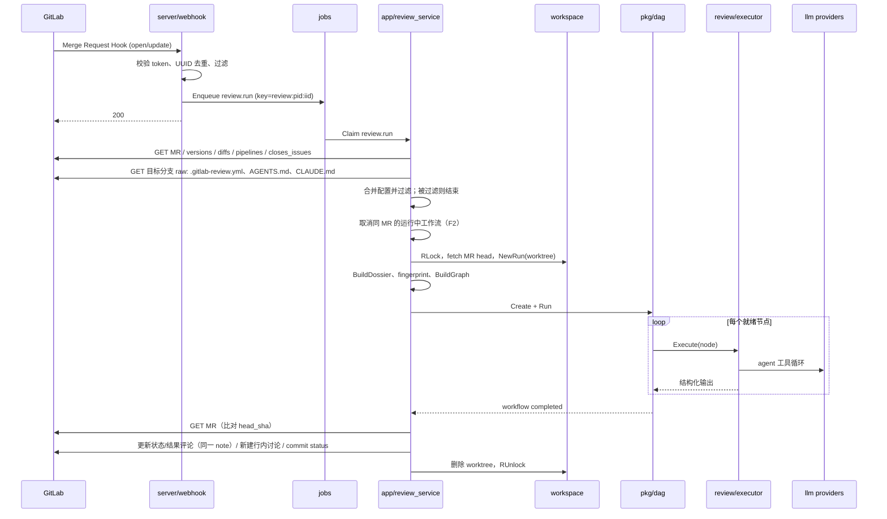

# 05 关键流程

> 每个流程列出参与组件、步骤和调用的 GitLab API。实现时按步骤写函数，每一步失败的处理也写在这里。

---

## F1 MR 打开或更新 → 评审 → 发布



### 步骤与失败处理

| # | 步骤 | 失败处理 |
|---|---|---|
| 1 | webhook 校验、去重、入队 | 认证失败 401；请求体读取超时或存储失败 503（不写去重记录）；其他输入异常等返回 200。重发和 hook 状态见[运维指南](../operations.md#webhook-失败与恢复) |
| 2 | worker 领取 job | 租约 5 分钟，执行中每分钟续期 |
| 3 | 取消旧工作流（F2；在采集和过滤后） | 过滤命中时不会到达此步 |
| 4 | 拉取 MR 元数据：`GET /projects/:id/merge_requests/:iid` | MR 已关闭或合并 → job 完成，不评审 |
| 5 | `GET .../merge_requests/:iid/versions` 取最新版本的三个 sha，并保留 `state`、`real_size` | 失败 → job 重试 |
| 6 | `GET .../merge_requests/:iid/diffs`（翻页）；用 diff version 的 `state`/`real_size` 和 MR 的 `changes_count` 核对总数；`too_large`/`collapsed` 文件按上限用 repository files/raw API 拉取 base 与 head 正文并重建 diff | 失败 → job 重试；列表为空但 GitLab 报告仍有变更文件 → 可重试错误，不当作空 MR；`state` 不是 `collected` 或 `real_size` 带 `+` 时记录覆盖缺口 |
| 7 | `GET .../merge_requests/:iid/pipelines`，取最新一条；有失败 job 时 `GET /projects/:id/pipelines/:pid/jobs` | 失败不阻塞，`Pipeline=nil` |
| 8 | `GET .../merge_requests/:iid/closes_issues` | 失败不阻塞 |
| 9 | 读目标分支上的 `.gitlab-review.yml`、`AGENTS.md`、`CLAUDE.md`：`GET /projects/:id/repository/files/:path/raw?ref=<target>` | 404 视为没有 |
| 10 | 合并配置（平台 → 项目 → 仓库）；worker 按合并后的设置复核 Draft/标签/目标分支（`allow_repo_config=true` 时包含目标分支仓库配置）；计算 ignore；记录 included、ignored、generated、omitted 和变更总数；增量范围 | 项目设置无法安全解析，或已启用的仓库配置 YAML 解析失败 → 停止此次执行，不回退为较宽松规则；被过滤的自动评审在创建 workflow 前结束 |
| 11 | 工作区 `RLock`；`git fetch refs/merge-requests/<iid>/head`；`git worktree add <runs>/<wf> <head_sha>`；共享 `base/` 的 HEAD 不等于 MR `start_sha` 时 fetch 目标分支并创建 `<runs>/<wf>-base`；仍无法证明 base 时记录 `metadata.base_identity=absent` 与覆盖缺口警告；共享索引不能证明就是目标提交时，另为该 base 建[目标图谱](#目标图谱)（在步骤 12 确认有文件要评审之后） | fetch 失败 → job 重试；base 不可用不阻断评审，但缺口进入 dossier 与摘要评论；目标图谱建不出来或超时同样不阻断评审，降级为不提供已绑定的 MCP 工具并记录 `tool_gaps`（不能 PASS） |
| 12 | 变更文件为 0：全被 ignore → 发布「无需评审」的汇总；全被采集缺口 omitted → 不建 workflow，发布 INCOMPLETE 摘要，列出 omitted 总数、原因计数和最多 4 条路径，其余只计数。两者都结束 | — |
| 13 | `BuildGraph` → `Engine.Create` → `Engine.Run` | 工作流 failed → F1-失败分支 |
| 14 | 发布（F7） | GitLab 写入失败 → 重试 3 次；可重试失败保持 `publication_state=pending`，永久失败标为 `failed`；控制台可手动 republish |
| 15 | 关闭目标图谱（先停其 MCP 服务器，再删除 `graphs/<runID>/`），清理 worktree，释放锁 | 正常路径清理失败只记日志，不改变已完成评审；后台 run cleanup 定期删除未被引用且超过 `workspace.run_cleanup_after` 年龄的遗留 run 和目标图谱目录 |

> 实际执行顺序：步骤 1–2 后，先做步骤 4–10 的采集、配置合并和过滤；未被过滤的自动评审才执行步骤 3 的取消，然后继续步骤 11。

> 触发重判：MR update 缺少 `oldrev` 时，webhook 与持久化 `review_control.head_sha` 比较 head；head 变化直接入队。head 不变时只有事件携带 `changes` 且显示 Draft→Ready、标签或目标分支从「被过滤」转为「可评审」才入队，避免标签/描述编辑造成重复评审。认证失败的投递记录为 `rejected`（`invalid_secret`），项目 token 的 401/403 使任务立即终止重试并在控制台标红。

> 空评审（步骤 12）不创建工作流，也不新增 skipped 工作流记录。全部被 ignore 时仍是「无需评审」的 PASS 摘要；全部变更文件都是 generated 时同样发布「无需评审」摘要，而不是让 required 的 plan 报没有可评审文件；全部变更文件都因 `max_files`、`max_diff_lines` 等硬采集缺口 omitted 时，不创建空 workflow，只发布 INCOMPLETE 摘要：列出 omitted 总数、原因计数和最多 4 条路径，其余只计数；正常 dossier 保留完整的 omitted 列表。`too_large`/`collapsed` 文件先尝试按上限拉取正文参与评审；取不到时降级为 warning（明确列出未审文件），不单独把整单改判 INCOMPLETE。该记录方式沿用 2026-10-23 用户确认的 Issue #10 本地验收口径；历史记录不补造不存在的 dossier 或逐路径 omitted 清单。发布前的最终代次检查会拒绝检查时已被新代次取代的结果。

> `DiffSummary.files` 表示进入材料快照的文件数，不是已评审数；`ignored` 是规则排除，不算覆盖缺口；`generated` 是被跳过的生成文件数。硬 omitted、GitLab 报告但未送达的文件、评审节点实际遇到的文件/包文本截断、完成 plan 后 included 文件未分配给评审节点、review 通道证据不足或 gate BLOCKING 无 accepted finding 时，评审继续执行但最终 verdict 为 INCOMPLETE，不能无提示 PASS；已有已发布 P0/P1 时保留 BLOCKING。
>
> 现有限制：最终检查与 GitLab 写入不是原子操作。新代次若在两者之间到来，旧摘要仍可能写入；后续评审成功发布时会更新汇总，没有后续成功发布时不保证自动纠正。因此不能把当前实现解释为「过期摘要绝不会发布」。

**F1-失败分支**：工作流 `failed` 时，若项目设置 `post_failure_note=true`（默认 true），发布或更新状态/结果评论为「⚪ 评审未完成：<原因>」，不写 commit status。

模型循环在至少完成一轮后失败时，agent 会返回已发生的 partial usage。非 `synthesize` 节点仍只对 transport 错误重试；每次重试把上一次已知 partial usage 带入下一轮共享预算检查，最终节点 usage 也包含这些已知用量。上游未返回 usage 的请求仍无法精确计量，跨重试只能按已知 token 边界使用，不能当作完整用量。`synthesize` 的预算中断或 transport 失败不重试，直接使用确定性规则兜底，并保留这次调用已知的 partial usage；兜底不是重试成功。

Anthropic 的输入用量将未缓存、缓存读取和缓存创建各计一次，缓存字段仅作明细；执行器和调度器的 token 预算使用完整输入与输出。v1.4.0 起不再估算或展示金钱成本；历史已保存用量不回填。

### 增量评审

- 上次已发布的工作流记录了 `head_sha`。新工作流在 `trigger=mr_update` 且非 `full` 时，只把 `git diff <last_head>..<head>` 涉及的文件作为评审范围；diff 内容仍取 MR 相对 base 的完整 diff，以保证行号映射正确。
- 上次的 head 不再是当前 head 的祖先（force push）→ 自动退回全量。
- 过滤评审范围时，没有 `path` 的 finding 保留为「无法定位」条目并参与最终 verdict；某一路在范围外文件上报了 P0/P1 时，该 finding 仍被过滤，但同时产生一个未解决信号，避免窄范围结果被当成干净的 PASS。
- 本次评审范围以结构化字段披露：dossier 的 `incremental`（是否全量、上次 head、增量文件）和 `SynthesisResult.scope`（`full`、`head`、`last_head`、`files`、`file_count`、`unlocated`）。`files` 最多保存 200 条，`file_count` 是完整增量文件数；摘要渲染为「评审范围」段（全量 / 增量、上次与本次 head、覆盖文件数、无法定位数；增量时明确「结论仅覆盖本次增量变更的文件」），生成文件的数量与路径同样在该段披露（`DiffSummary.generated` / `generated_paths`）。行内正文与汇总条目逐字完整发布，不按内容长度截断；`evidence`/`suggestion`/`reason` 的生成侧契约上限（64,000/64,000/8,000 rune）只由 `Validate` 强制，渲染层不据此裁剪，更长内容由节点 `max_tokens` 与契约上限共同决定。发布侧唯一上限是 GitLab 平台字节上限：超过时按逐条累计字节预算渲染，省略放不下的尾部完整条目并标注「余下内容见控制台」，不切断代码块、`<details>` 块或多字节字符。结论长度由 `prompts/main.synthesize.md`（1–3 句、不超过 3000 字符）与节点级 `max_tokens`（控制台 `NodeParams`，键 `synthesize` / `synthesize.2`）决定。

### 目标图谱

共享工作区索引（`workspaces.index_sha`）只跟随一个提交，不能证明就是评审的目标提交（MR diff 的 `start_sha`）时，评审为自己的 base checkout 建一份只属于这次评审的代码图谱（[#604](https://github.com/LeXwDeX/Tribunal/issues/604)）。运行时行为、成本和排查见[运维手册](../operations.md#目标提交代码图谱)，配置规则见[配置设计](06-config.md#目标提交代码图谱)。

- **启用条件**（同时满足）：共享索引不满足使用条件（`index_sha` 与 `start_sha` 不一致，或工作区不是 `ready`、带有 `last_error`）；有效 ignore 未受限；所有配置了 `x-review.index_command` 的 MCP 服务器都是 stdio。共享索引满足条件时不额外索引。
- **时机**：在持工作区读锁、base checkout 已在 `start_sha`、且步骤 12 确认有文件要评审之后才建，全被 ignore 或全被 omitted 的空评审不付索引成本。续跑原快照允许 MCP 的评审（job 重试续跑，或进程重启后的恢复，见 F6 第 3 步）时重新建。
- **建立与路由**：创建空的 `graphs/<runID>/`，用一个只含这些服务器、以该目录为工作区的独立 MCP manager 运行 `index_command`，前后核对 base 的 HEAD 仍是 `start_sha`；带索引命令服务器的工具从该 manager 绑定，其他 MCP 服务器仍走项目共享 manager。dossier 的 `workspace_provenance` 记 `index_sha=start_sha`、`index_source=run`、`mcp_eligible=true`；资格证明不放宽，索引 SHA 仍须等于目标提交。
- **降级**：建图谱失败或超时（等待并发名额最长 5 分钟，取得名额后索引最长 10 分钟，进程内最多 2 个同时运行；同一提交与索引配置失败后 15 分钟内不重试）不使评审失败。评审照常完成，按原规则不提供已绑定的 MCP 工具并记录 `tool_gaps`（不能 PASS），同时记 WARN `target code graph unavailable; continuing without it`，字段只有 `project_id` 与固定词 `error_class`。父任务取消或出站令牌失效时，评审报错并按 job 重试，不降级。
- **生命周期**：等同这次 run，不跨评审缓存。步骤 15 先关闭 manager 再删除 `graphs/<runID>/`；进程崩溃遗留的目录由后台 run cleanup 回收（F6 第 5 步）。

---

## F2 新 push 取消旧评审

1. webhook、已授权的评论命令或手动 API 在入队事务内记录同 `(project_id, mr_iid)` 的最新评审代次或取消意图。重复 delivery 不增加代次。
2. 取消不能依赖领取同 key 的后继 `review.run`：M0 队列只会在旧任务结束后领取后继。控制任务独立于长评审执行；运行中的评审也检查持久化意图，不能只靠内存通知。
3. 旧评审在创建工作流前检查代次，运行中发现已被替代时调用 `Engine.Cancel`。取消返回前应持久化工作流终态，并取消节点 context。用户取消不作为可重试的执行失败。
4. 旧工作流不会发布任何内容。发布前同时检查代次与完整 fingerprint，拦住创建前取消、进程重启和迟到结果。
5. 旧 job 结束后，新工作流开始 F1 第 4 步。即使 `jobs.workers=1`，控制路径也必须可执行。

merge/close webhook 的自动取消只在两种情况下被忽略：从未评审过的 MR（没有 control/status 行，也没有活跃或排队的评审 job/workflow），以及已终态但没有已发布正文的评审（如 failed/cancelled/stale 且 `final_body` 为空）；此时 webhook 结果为 `nothing_to_cancel`，不创建 control/status 行，也不产生「评审已取消」评论。已有已发布正文（`final_body` 非空且 `final_body_ready = 1`）的 MR 不再被忽略：取消照常推进 generation 并写入 `cancelled` 状态，但逐字保留 `final_body` 与 `final_body_ready`，合并评论只把生命周期头部改为取消阶段，原评审结论与 finding 列表不变。仍有活跃或排队评审时照常取消。`/review cancel` 命令与手工取消 API 的原有语义不变，只是同样保留已发布正文（见 F3）。

---

## F3 评论命令与 @ 唤醒

Note Hook 统一先持久化为 `review.command`，以下 GitLab 校验由 worker 执行，不在 webhook handler 内执行。worker 完成权限校验、help/拒绝回复和目标任务入队；它不执行评审。受理 run/cancel 时，入队事务记录源 note 的 eyes；help/拒绝不添加表情。webhook handler 不添加 emoji，也不做网络调用。

1. Note Hook 到达且 `action=create`。编辑注记不触发（保留 `action != create` 过滤）；MR 已关闭或合并时忽略。
2. 判定触发类型：首行是 `/review` 斜杠命令时走命令分支；否则尝试 `@` 提及。
3. 斜杠命令分支忽略 bot 作者的注记。mention 分支允许第三方 bot（`user.bot=true` 且用户名不在 `bot_usernames` 中，常用 access token 的 agent 即属此类），但仍忽略：`bot_usernames` 中的本服务账号（元素先 trim），以及以 `command-reply`、summary、legacy status、finding 标记开头的注记；worker 的 `CurrentUser` 身份比对是最后兜底。mention 目标取自 `gitlab.bot_usernames`，列表为空时禁用；匹配大小写不敏感、要求完整用户名边界（`@` 前一个字节为非词字符或行首；用户名后一个字节不得为 GitLab 用户名字符 `[A-Za-z0-9_.-]` 或行尾）。匹配前先剥离围栏代码块、4 空格/制表符缩进代码、行内代码（以空格占位）、autolink、Markdown 链接目标与裸 http(s) URL，避免引用文本误触发；剥离为线性单遍扫描。正文超过 128 KiB 时直接按「未提及」处理，避免任意评论者用超长注记消耗 ingress 的 900ms 预算。
4. 校验权限：斜杠命令固定要求 Developer（30）；mention 使用 `gitlab.mention_min_access_level`（默认 30，允许 10/15/20/30/40/50）。不足时 worker 在源讨论线程内回复 denied 文案，丢弃命令，不创建评审任务。mention 与自动触发一样经过项目过滤规则（`skip_draft`、标签、目标分支）；被排除时 worker 在线程内回一条 `filtered` 说明，不入队、不运行评审。斜杠命令仍保留既有绕过过滤的语义。
5. 解析命令（03-http-api.md §6）：
   - `/review`、`/review full`、`/review default` → 入队 `review.run`（trigger=`command`，带 `full`、`profile`、`triggered_by`）。
   - `/review cancel` → 入队 `review.cancel`。
   - `/review help` → worker 回复可用命令和档位说明，不创建评审任务。
   - `@<bot>` → 入队 `review.run`（trigger=`mention`，项目默认档位，`full=false`），payload 透传源注记的 `discussion_id`。mention 为显式触发，按全量范围评审：评审服务只对 `mr_update` 与 `catch_up` 使用增量范围，`mention`/`command` 与首次评审一样走全量（help 文案把 `/review` 写成「增量」是既有偏差，本轮不修）。
6. 回复都在源讨论线程内接续：`commandPayload.discussion_id` 非空时定位该线程；旧 payload 缺字段时先用 `ListDiscussions` 反查包含源 note 的线程，仍找不到才回落顶层注记（保持旧行为）。显式线程不在列表中时仍用 `ListMRNotes` 按 marker 去重；向已删除线程追加返回 404 时回落顶层回执，其他错误仍重试。回复正文只包含 ack（accepted/denied/help/cancel/uncertain/filtered）、一行 head/代次和指向唯一状态注记的 permalink，不复制状态表格、不新增完成注记；finding 仍走行内 discussion。受理 run/cancel 时，入队事务在源 note 上设置 eyes；任务进入终态后，状态 worker 将自有 reaction 协调为完成/失败标记或清除。help/拒绝不添加表情；webhook 自身不添加 emoji，也不做网络调用。机器人评论、command-reply note 与本服务标记注记不会再次触发；同一源 note 不重复入队，同 head 的重复 @ 走既有 latest-wins 合并。
7. 两类回复都使用 worker 自己的隐藏 per-note marker（`command-reply note=<source_note_id>`），按 marker + bot 作者在线程内查找并原地更新已有回复，因此任务重试不会重复创建。重复命令身份（store 返回 `duplicate`/代次 0）不重写已存在的 accepted 回执，保留其「代次」行。

---

## F4 目标分支 push → 刷新工作区

1. Push Hook 到达，`ref` 匹配目标分支 → 入队 `workspace.refresh`（key=`ws:<pid>`，自动合并重复）。
2. 工作区 `Lock`（等待进行中的评审释放读锁，最长 10 分钟，超时则延后重试）。
3. `git fetch`，`base/` 检出到新的 `after` sha；`workspaces.base_sha` 更新。
4. 外部索引增量更新（如 `codebase-memory-mcp cli index_repository`，cwd 为 `base/`）。只有项目或仓库追加的 ignore 规则（超出内置默认 6 条）才阻断索引；内置默认规则不再阻止索引和管理员绑定的 MCP 工具。工作区 `last_error` 仍是 `index: blocked by ignore policy` 而当前策略已不受限时（#457 之前写入的过期状态），无论是否请求 reindex 都重建索引（[#618](https://github.com/LeXwDeX/Tribunal/issues/618)）。非取消的索引失败不阻断刷新，保留旧 `index_sha`；其他必要步骤及状态保存成功时最终 `state=ready` 并记录固定的索引失败消息。
5. 判断是否重新生成上下文文档：以当前生效上下文文档的 base 为起点，比较其到新 base 的**累计**变更文件数 ≥ `context_refresh.changed_files`，或距**最后一次成功生成**的时间 ≥ `context_refresh.max_age`，且当前文档未锁定 → 运行 onboarding 工作流（F5 第 4 步起）。普通工作区刷新不推进该时间锚点，持续小批量 push 会累计漂移。
6. 释放锁。

**其他刷新触发与默认分支**（[#604](https://github.com/LeXwDeX/Tribunal/issues/604)）：`workspace.refresh` 也由手动刷新（控制台「刷新工作区」或 `POST /api/v1/projects/{id}/workspace/refresh`）、启动追赶扫描（trigger `catch_up`）和评审准备或 webhook 载荷（`project.default_branch` 与存储值不同）发现默认分支变化（trigger `default_branch_changed`）入队；启动时对 #457 之前写入的过期 ignore 阻断状态另排队一次带 `reindex=true` 的刷新（trigger `stale_ignore_block`，见[运维手册](../operations.md#ignore-策略与索引)）。这几类都表示“刷新默认分支”：执行时不使用入队时记下的分支，而是在读取 GitLab 项目时先同步存储的默认分支（`projects.default_branch`；GitLab 报告的值非空、是合法分支名且与存储值不同才更新），再取当前默认分支的最新提交作为第 3 步检出的目标。push 触发的刷新（trigger `push`）仍取 push 的 `ref`，只有推的正是同步前存储的旧默认分支且默认分支已变化时改取新默认分支。onboarding（F5 第 4 步）同理。同步失败只记 WARN，不影响刷新。同步条件、日志与限制见[运维手册](../operations.md#默认分支同步)。

---

## F5 项目注册与 onboarding

1. 已登录用户（平台管理员也可代为执行）调用 `POST /api/v1/projects`（03-http-api.md §4.1），服务端校验 token 和 scope。普通注册人的 token 必须能识别出该项目至少 Reporter 的成员；平台管理员与静态 bootstrap Bearer 免此检查。本地注册人（用户 ID > 0）在同一事务获得该项目的 `manage` grant。
2. 可选：创建 webhook。
3. 入库，`workspaces.state=new`，入队 `workspace.onboard`。
4. onboarding job：
   1. `state=onboarding`；`EnsureMirror` + 检出 `base/`（取默认分支，读取 GitLab 项目时先同步默认分支，见 F4）。
   2. 建外部索引（按平台和项目配置的 MCP 中声明了 `index_command` 的服务器）。
   3. 读取目标分支上的 AGENTS.md / CLAUDE.md。
   4. 创建 onboarding 工作流（单节点），产出 `OnboardingOut`。
   5. 渲染为 Markdown，追加到 `context_docs`（`source=generated`）；若当前 active 版本已锁定，新版本保存但不切换。
   6. `state=ready`。
5. 进入 onboarding 后的关键步骤失败时，尝试设置 `state=error`，`last_error` 使用固定消息，不记录错误原文。非取消的索引失败是例外：继续生成上下文，生成及状态保存成功后 `state=ready` 并记录固定的索引失败消息。预检查或锁失败沿用直接返回的行为；取消后 context 已失效时，状态保存也可能失败，不能保证一定写入 `error`。

---

## F6 崩溃恢复

服务启动时依次执行：

1. `jobs`：`state=running` 且租约过期的任务改回 `queued`；`attempts` 只在下一次领取时加一，避免重复计数。已达到 `max_attempts` 的标为 `failed`；若已有同 key 的更新 queued 后继，取消旧任务而不覆盖后继。
2. 应用层先恢复工作流对应的脱敏材料快照、配置与 prompt 快照、工作区读锁及 head worktree，再调用 `Engine.Recover`。不得重新采集当前输入并与已完成节点的旧结果混用。对每个未终态工作流，
   - `running` 节点：写 `node.restarted`，重置为 `pending`，`attempt+1`。
   - `queued` 节点：保持 `queued`（幂等重入）。
   - 然后重新进入调度循环。
3. 评审节点无副作用，重跑安全。job 重试关联原工作流，不重跑已完成节点。已有 run worktree 必须校验 HEAD 后复用；缺失时从 mirror 恢复。材料缺失或 base 漂移时明确失败，不混跑。原快照允许 MCP、但共享索引已不匹配其 base 时（例如图谱原本由[目标图谱](#目标图谱)提供），重建 per-run base 与目标图谱后继续；仍无法证明索引才以 `index_ineligible` 取消。
4. 还需恢复「已完成但尚未发布」的工作流；它们不属于引擎的未终态集合。发布阶段靠 F7 的幂等恢复：`publication_state=pending` 的终态工作流在启动后重试；failed execution 按 `post_failure_note` 发布未完成摘要或记为 skipped；取消/被新代次替换记为 skipped；自动恢复不会覆盖 published/failed（手动 republish 是显式例外）。失败或跳过原因有界、脱敏保存，材料快照、事件和日志不得含项目 token、provider key 或 MCP 密钥。
5. 后台 run cleanup 服务随 `StartBackground` 启动：启动后立即执行一次，之后每小时执行。它先查询 `workspaces` 表、全局 run 保护引用和每个项目的 context 保护 SHA，再在项目写锁内触碰项目文件；任一必要查询失败即不对该项目删除，项目列表查询失败则整轮不删除。
   - run 保护包括非终态 workflow、queued/running job、`publication_state=pending` 的 dossier（workflow_id 和 job_id），以及本进程 workspace manager 仍注册的 run。超过 `workspace.run_cleanup_after`（默认 1h，是年龄阈值而非清理周期）且不受保护的 `runs/<id>` 才删除；删除前先移除 Git worktree 关联。缺失 mirror 时只有已通过年龄、引用保护、本进程注册和路径检查的 run 才允许删除，其他 Git 失败保留目录。mirror 存在但 run 目录未注册为 worktree（如 `AddWorktree` 失败留下的孤儿）时保留目录并记录错误。
   - `context/<sha>` 目录同样按该年龄阈值清理，但必须保留所有 `context_docs` 记录引用的 base SHA、workspace 的 `base_sha`/`context_sha`、未终态 workflow 的 base，以及 `publication_state=pending` dossier 的 base。目录 metadata 标记 locked、不可读或非法时保留该目录（fail closed）。
   - `graphs/<runID>` 目录（评审的[目标图谱](#目标图谱)）同样在项目写锁内清理：评审结束时自行删除目录，且整个 run 期间持工作区读锁，所以写锁下仍存在的目录是进程崩溃遗留。只有早于 `workspace.run_cleanup_after`、run ID 不在上述 run 保护集合且不是本进程 workspace manager 注册的 run 的目录才删除；符号链接、普通文件和名称不是合法 run ID 的条目保留。`run cleanup finished` 日志用 `removed_graphs` 记录本轮删除的目录数，与 `removed_runs`、`removed_contexts` 并列。
   - 路径不是目录、为符号链接或不在项目根内时跳过/报错；项目缺少 `workspaces` 行时不会被遍历。

---

## F7 发布（幂等）

前置：工作流 `completed`。

1. **fingerprint 校验**：重新检查当前 MR 的 head/base、有效配置哈希、prompt 版本和持久化评审代次。任一不一致则不发布，记录 stale 原因；不能只比对 `head_sha`。发布期间保持工作区读锁。
2. **状态/结果评论（同一 note）**：
   1. Publisher 先调用 `SetReviewStatusFinalBody`，把渲染好的评审报告写入当前代次的 `review_status.final_body`，再用与状态 worker 相同的 `reviewStatusBody` 渲染（生命周期表格 + 结果）并更新同一条 note；`publications(kind=summary)` 仍记录该 note，`gitlab_id` 指向它。写入使用本次发布自己的 generation/head（来自 workflow dossier），不采用写入前重新读取的 control 值；store 要求该 generation/head 仍是当前代次，期间有新评审激活时以 `ErrSuperseded` 拒绝，发布按 stale/skipped 结算。终态后仍允许写入，因为 summary 在工作流结算后发布。没有评审 control 行时退回只维护独立 summary note（兼容路径）。
   2. 独立 summary 兼容路径（没有评审 control 行）先查 `publications(kind=summary)`；有 `gitlab_id` → `PUT .../notes/:note_id` 更新。统一路径不读该绑定，直接进入下一步的标记查找，找到后再写回绑定：绑定可能由另一身份写入（切换项目/共享凭据或更换 GitLab 用户），按旧 `note_id` 更新会被 GitLab 以 403 拒绝，重试与启动恢复会永远停在 pending（#514）。
   3. 没有记录（兼容路径）、统一路径（始终），或兼容路径更新绑定评论返回 404 → 确认本 bot 身份并列出 MR notes。兼容路径 404 的旧评论若仍在列表中，保留错误而不新建；否则找作者为本 bot 且正文以 `<!-- gitlab-ce-review:summary` 开头的评论，找到则复用或更新，找不到才新建，再写入绑定。统一路径只编辑作者为本 bot 的注记：命中另一身份的旧注记时不更新（GitLab 只允许作者编辑），改为新建并重绑；身份或列表查询失败时停止恢复。
   4. 正常摘要、失败摘要和行内降级后的摘要使用相同恢复路径；恢复写入和重试前复核已存代次及非空 head。检查与在途 GitLab 请求不原子，不能保证旧写入绝不会发生。
   5. 同一条 note 由 publisher 与状态 worker 共同维护：publisher 先把 `final_body` 持久化并更新 note，写入失败按发布失败路径重试；状态 worker 之后用 `row.FinalBody` 渲染，两个写入方收敛到同一正文。状态作业自身的写入失败由 `review.status` 对账重试，不改变已完成的评审结论。
   6. 同一 MR 的远端注记写入由进程内共享的 per-MR 锁串行（#475）：publisher 的 summary、行内讨论与 commit status，状态 worker，命令回复，以及令牌失效或仓库配置无效时的回落注记，全部持同一把锁（key 为 `projectID:mrIID`）；除 webhook ingress 在 DB 事务内推进代次外，所有 generation bump 路径（手动触发与取消、`/review` 命令、候选激活、启动 catch-up）也持同一把锁。需要代次栅栏的写入方（publisher、状态 worker、回落注记）在锁内复核 generation/head，过期代次不写；命令回复按源 note 幂等更新、不做代次栅栏，但同样持锁以避免与发布或状态写入交错。因此新代次的摘要/状态注记不会落在旧代次写入之前。webhook ingress 不持该锁：它只做投递记录、代次推进与 DB 入队，以守住 900ms 处理预算；注记全序由「写入方持锁 + 需要栅栏的写入在锁内复核代次」保证，而不是让 ingress 等待远端写入。锁序固定为生命周期锁 → 工作区内容锁 → per-MR 锁 → workflow 锁，不反向获取、不重入。GitLab 没有条件写入，超时或崩溃后的旧请求仍可能短暂覆盖新内容；两个写入方渲染同一正文，下一次更新会收敛，周期复核会恢复当前状态（见[状态评论恢复](../operations.md#状态评论恢复)）。
   7. `review_status.final_body_ready = 0` 的历史行由状态 worker 继续用旧 `<!-- gitlab-ce-review:status v1 -->` 标记原地更新旧状态评论，不按 summary 标记查找或改写已发布的评审报告评论；这条不变量在正常更新与终态回退（control 缺失、同代次 head 变化、当前代次取消）路径上都成立，历史行的已发布 summary 正文逐字不动。publisher 写入 `final_body` 后该行置为 1，转入上面的同一条 note 合并模式，由合并注记承载已发布正文，并在每次收敛写入时删除本 bot 的旧 `:status` 注记（只匹配当前 token 身份与旧标记前缀，外部作者和合并注记永不命中）；清理也覆盖正文相同与拒绝回退的早退路径，重启后不会残留。升级前遗留的独立 summary note 不在清理范围内。取消不丢已发布结论：所有取消入口（webhook merge/close、`/review cancel`、手工取消 API）保留已发布的 `final_body` 与 `final_body_ready`，只更新生命周期头部；新评审导致的 generation 前进才清空正文，等待新发布重写。
3. **行内讨论**：对 `decision ∈ {publish, mark}` 且 `position_ok` 的 finding：
   1. 发布键改为**位置键** `review.PositionPublishKey(path, line, side)`：`pk_` + sha256 前 16 字节十六进制，只含规范化侧别（`old`；空或 `new` 按 `new`）、去首尾空白的路径和正整数行号，不含标题、证据、正文或工作流指纹。同一位置跨代次稳定；路径为空或 `line <= 0` 返回空键，不发布行内讨论。锚点经 `gitlab.DiffIndex` 定位后再由 `review.PositionAnchorKey` 规范化：context 行同时带 old/new 行号，同一物理行上的 finding 不论按哪一侧报告都归一到 new 侧及其 new 路径/行号，共用一条讨论；新增行、删除行只有单侧行号，保持各自侧别。采集、渲染与生命周期收敛共用这一函数。
   2. 按规范化锚点（file+line+side）分组发布一条讨论。同一锚点有多个 finding 时渲染到同一条 discussion，用 `### [P]标题` 分节，按严重级别、规范化标题、ID 稳定排序；单条 finding 保持 `**[P]标题**` 平铺格式。正文首行仍是隐藏标记 `<!-- gitlab-ce-review:finding key=<位置键> -->`，下一行是可见的 `<sub>代次 N</sub>`，末尾仍追加隐藏的 workflow 标记。
   3. 已有位置键发布记录时，按记录的 GitLab discussion ID 在讨论列表中找到该线程，只更新本 bot 的首条 note（`PUT .../notes/:note_id`）；更新路径不删除讨论、不 resolve、不改动用户回复；正文相同则不写。线程已不存在、首条作者不是当前 token 身份或首条没有 finding 标记时，本轮该位置留在摘要并提示「历史讨论内容…无法确认」，不再新建同位置讨论。
   4. 没有位置键记录时先尝试复用旧线程。候选为：（a）当前 finding 旧指纹键对应的 `discussion` 发布记录所指线程；（b）该 MR 其它历史 `discussion` 发布行所指线程——措辞变化会让旧指纹键不再等于当前键，因此还要按远端 note position 或历史 finding 证据匹配；（c）远端首条带 finding 标记、且 GitLab note position 的 path/line/side 与规范化锚点一致的线程。取 note ID 最大（最近）的一条。首条作者必须是当前 token 身份；首条标记键必须是当前位置键，或是本轮其他位置键之外的旧键（旧指纹键或规范化前的位置键）；旧发布记录指向的线程若没有 GitLab position 元数据，还要求持有该发布键的 finding 本身（而非同位置第一条 finding）路径、侧别、类别一致且行号相差不超过 3 行。同一轮内每个 discussion 只绑定一个位置：已认领的线程不再被第二个位置复用。更新正文后写入位置键记录，并把该位置键下未确认的讨论意图结算为已确认（adopted discussion ID）；意图若已绑定其它远端 ID 则不覆盖，该位置退回摘要。存在候选但归属无法证明时同样留在摘要，不新建重复讨论。旧指纹键的 `publications(kind=discussion)` 行作为只读历史保留，不删除、不重写、不改归属。
   5. 没有候选时沿用既有讨论意图（`discussion_intents`）与 `POST .../discussions` 流程，发布键改为位置键；已有意图时不重复创建，未知远端 ID 须通过当前机器人身份和唯一首条标记恢复，否则保持待处理；400/401/403/404/422 的确定性拒绝语义不变。新建成功后写 `publications`（位置键）和正文哈希；仅从意图恢复的远端 ID 不证明工作流或正文，只有正文与当前渲染（含本工作流标记）完全一致时才补写发布记录，否则当前问题留在摘要并提示。
   6. 每个位置只有分组中的第一条（主 finding）在 findings 表中保存位置键，同位置其他 finding 保留原指纹键，因此反馈采集仍按 publication 键唯一匹配；旧工作流的指纹键 finding 和旧 `discussion` 行不变。
4. **commit status**（项目开启时）：`POST /projects/:id/statuses/:head_sha`，`name=ai-review`，只有 PASS 写 `success`，BLOCKING 和 INCOMPLETE 写 `failed`，`target_url` 指向控制台评审详情，`description` ≤ 140 字符。调用成功后以 `publish_key=status:<head_sha>:<state>` 记录 `publications`；旧格式 `status:<head_sha>` 没有状态，评审详情视为未知，不根据 verdict 推断。commit status 的 failed 是评审结论，不是发布失败。
5. 写 `publications` 与调用 GitLab 不在同一事务。崩溃导致漏记时，第 2.3 步的标记查找可以兜底状态/结果评论；行内讨论依靠先持久化的意图和远端标记避免盲目重建，未知结果保持待处理。创建讨论返回 400/401/403/404/422 时视为确定性拒绝：清除 intent、降级进摘要并终态发布；标记扫描成功但远端不存在对应讨论时同样清除 intent。未知结果超过 7 天由启动恢复记为 `failed`（固定原因），不再长期 pending。存储或同步保障损坏、恢复旧快照等限制见运维文档。
6. **讨论生命周期**：评审结论为 PASS 或 BLOCKING 时，按首条标记识别本 bot 的 finding 讨论。current keys 对有可用位置的已发布 finding 仅在该位置线程确实存在时使用规范化位置键（与发布同一 `review.PositionAnchorKey`，context 行归一到 new 侧）：远端正带该位置键 marker，或位置发布记录指向一个可见线程；否则沿用 finding 的指纹键。这样本轮只进摘要、远端仍是指纹键 marker 的线程不会被误判为过期，而已成功按位置发布（即使只进摘要）的线程仍保持当前。无可用位置的 finding 保留指纹键回退。当前 finding 仍存在但讨论已 resolved → 重新打开；讨论的 finding 不再出现在当前结果（包括旧代次遗留的重复线程）→ resolve。INCOMPLETE 评审不执行收敛，避免把未覆盖误判为已修复。finding 讨论只做 resolve/unresolve，永不删除；GitLab 客户端新增的 `DeleteMRNote` 只用于清理本 bot 的 legacy `:status` 注记（见第 2.7 步）。

**状态评论正文**：

````markdown
<!-- gitlab-ce-review:summary v2 -->
**AI 评审：发现问题（BLOCKING）**

| 阶段 | 状态 | 代次 | 提交 | 预计 | 详情 |
| --- | --- | --- | --- | --- | --- |
| 已完成 | `BLOCKING` | `3` | `9f3c2a1` | - | - |

<review_status.final_body 渲染出的评审报告，原 summary 首行 marker 已移除>
````

- 阶段只有四类：`开始`（`received`、`queued`）、`进行中`（`running`、`publishing`）、`已完成`（`PASS`、`BLOCKING`、`INCOMPLETE`）、`失败`（`failed`、`cancelled`、`stale`）。状态列保留反引号包裹的原始状态枚举；代次与 7 位短提交也用反引号；预计为「约 N 分钟」或 `-`；详情经控制字符清洗、token/URL 脱敏与 160 rune 截断，管道符转义，空值显示 `-`。整个正文经 `gitlab.NeutralizeQuickActions` 处理。
- `final_body` 为空（例如尚未结算，或 `final_body_ready = 0` 的历史行）时只显示生命周期表格；历史行此时继续写入旧 `<!-- gitlab-ce-review:status v1 -->` 评论，而不是同一条 summary note。工作流结算后 publisher 写入结果并把该行置为 1，状态 worker 之后的更新继续携带同一个 `final_body`。`SetReviewStatus` 在新评审或 head 变化时清空 `final_body`，同代次（含 stale/cancel 更新）保留；取消导致的 generation 前进在已有正文时通过 `PreserveFinalBody` 保留正文与 `final_body_ready`，只有生命周期头部变化，新评审才重置正文。
- control 缺失、同代次 head 变化或当前代次被取消时，状态 worker 写入终态（`stale` / `cancelled`）而不是永久停在「运行中」；已有更新代次时仍跳过，由新代次自己写。终态回退对历史行同样使用旧 `:status` 标记，绝不接管已发布的 summary 评论。取消结算回读状态行时校验 generation 与 head，只有仍属同一代次才采纳。
- 行转入合并模式后，本 bot 的旧 `:status` 注记在收敛写入时删除（含正文相同与拒绝回退的早退路径）；升级前遗留的独立 summary note 不会被迁移或自动删除，需要时人工清理。

2026-10-25 用户确认 Issue #3 按上述发布键边界验收：相同事件 UUID、相同发布键和同一评审的重复发布不新增重复评论。显式新评审仍可创建新代次；自 #487 起，行内讨论的发布键改为按 file+line+side 计算的位置键，不含标题、证据、正文或工作流指纹，同一位置跨代次更新同一条讨论，不再堆叠新评论。按位置收敛不等于跨位置的语义去重：代码行号移动会形成新位置，同一问题可能随位置变化另发一条讨论。

发布执行状态与 workflow 执行状态分开持久化：

- `pending`：执行已终态但 GitLab 发布未完成，可能是等待中的重试。启动恢复会先重试一轮；运行期每 5 分钟的 side-effect 对账也会扫描 completed/failed 的 pending 行并重试，同一工作流两次自动尝试至少间隔 15 分钟（dossier 的 `updated_at` 记录上次尝试），避免每次对账都翻转状态注记和 reaction。讨论结果未知（`publication_error` 为 `discussion outcome unknown`）不进入该扫描，仍按 7 天有界窗口结算；永久失败写为 `failed`，不自动重试。运行期也可手动 republish。
- `published`：状态/结果评论、失败摘要及需要写入的 commit status 已完成。
- `skipped`：fingerprint/head/config/prompt 已 stale、评审被取消或被新代次替换，或项目关闭 failure note；记录原因，不自动重发。
- `failed`：无法继续的永久发布失败（如 MR 已关闭），记录脱敏原因，需控制台或 API 手动 republish。

手动 republish 只接受 completed/failed 的终态工作流；它先把发布状态置回 `pending`，再重新执行同一套 fingerprint 和代次检查。若结果已 stale，仍会转为 skipped；failed execution 的 republish 只发布未完成摘要，不写 findings 或 commit status。失败原因不能包含上游响应正文或凭据。

---

## F8 反馈收集

定时任务（默认每 6 小时）：

1. 找出最近 14 天内**创建**且已完成的 review workflow（最多 5 页、每页 100 条），再读取对应 MR。MR 必须仍打开，或状态为 merged/locked 且 `merged_at` 在最近 14 天内（与 workflow 扫描窗口一致）；closed 或更早合并的 MR 不采集。
2. 对状态/结果评论和行内讨论的**发布者首条 note** 调用 `GET .../notes/:note_id/award_emoji`，记录 👍（`thumbsup`）/ 👎（`thumbsdown`）。discussion 的后续 note 是 reviewer replies，其表情不视为对已发布 finding 的反馈。状态/结果评论的 award 保持未关联 finding。
3. 行内讨论先调用 `GET .../discussions/:discussion_id`。只有已 resolved 且能定位到 finding 时才判断：只处理 `line > 0` 且 `side` 为空或 `new` 的 finding；`published_head == current_head` 记为 `resolved_unchanged`，否则取回 current head 后执行零上下文 `git diff <published_head>..<current_head> -- <path>`：
   - finding 行落在删除或替换旧行的 hunk 内，或文件被删除 → `resolved_changed`。
   - 文件未变、纯重命名或 finding 行未被 hunk 覆盖 → `resolved_unchanged`。
   - binary、无法映射到旧路径的 rename 或其他不可比较改动，或 old-side、缺行、MR/head 获取失败、diff 失败 → 不写 signal，留待下一轮重试。
4. 写入 `feedback`；discussion 先按 publication 的 `publish_key` 在同一 workflow/project/MR 中定位已持久化 finding，唯一匹配时写入其精确 `finding_id`。首条 note 的隐藏标记记录最后写入该线程的发布键：标记可解析且不等于本行 `publish_key` 时，这一行是已被取代的历史行（例如旧指纹键行指向已被位置键接管的同一 discussion），本轮跳过，避免同一次 👍/resolved 被历史行和当前位置行各记一条；标记不可解析时保持原行为。finding 查询失败或匹配多个 finding 时，该讨论本轮不采集，记录告警并等待下次重试；不写入无归属 signal，也不猜测归属。没有匹配或 publication 身份不一致时，仍保存 award 原始 signal，但新记录的 `finding_id` 为空；resolve 缺少可用 finding 时不写 signal。`UpsertFeedback` 按 publication、signal 和 GitLab 用户匹配，匿名信号使用 `IS NULL` 匹配；重复采集时，空 `finding_id` 不覆盖已有非空归属，非空归属可更新原值。成功写入会用本次采集时间更新 `observed_at`，因此统计窗口按最近一次观察时间计算，不是首次创建时间。
5. 控制台统计页展示 `stats.feedback` 的 `total`、`by_signal` 和 `by_provider` 原始计数，按项目和 `observed_at` 的 `[from, to)` 筛选（结束日映射到次日本地午夜）；空范围显示已知为零，旧响应缺少 `feedback` 字段时显示不可用。`by_provider` 每项为 `{provider, role, total, by_signal}`：`proposer` 取 `findings.origin_provider`，`challenger` 取 `challenge_node` 节点的 provider；只统计 `feedback.finding_id` 能精确连接 `findings.id` 且 publication 一致的 discussion；summary/unlinked 不计入 `by_provider`，但仍计入原始 `total`/`by_signal`。同一 signal 可同时计入两个角色。

采集失败按固定类别记录 WARN：`auth`、`not_found`、`rate_limited`、`upstream`、`store`、`credential`、`canceled`、`timeout`；日志只使用 `project_id`、`mr_iid`、`workflow_id`、`publication_id` 等标识和类别，不写原始错误正文。单行表 `feedback_collection_state` 记录最近成功一轮的 `last_collected_at` 与最近失败类别/时间：成功只推进 `last_collected_at`，失败只更新 `last_error_class`/`last_error_at`，`last_collected_at` 晚于 `last_error_at` 表示已恢复；`GET /api/v1/stats` 以 `feedback_collection` 返回该状态。

原始反馈不自动判断 finding 是否有效。管理员在评审详情展开 finding，选择有效、无效、未确定或清除后显式保存；标注接口记录认证用户名与服务端时间，viewer 只能读取。`ReplaceFindings` 在重新发布时保留同一 ID 的人工字段，不接受 producer 覆盖。标注更正不触发重新发布，也不改变 verdict。

统计页的 `quality_by_provider` 独立计算人工指标：提出方准确率 = 有效 /（有效 + 无效）；挑战方误杀率 = `refuted` 中人工有效数 / `refuted` 中人工有效或无效数。未标注和未确定不进分母，零分母返回 `null`，同时展示样本数。筛选按 workflow 创建时间，而非反馈观察或标注时间；来源及完整字段见 [统计 API](03-http-api.md#45-系统)。顶层 `overturned_ratio` 仍只表示规则裁决中 `drop` 的比例，不是人工误杀率。
